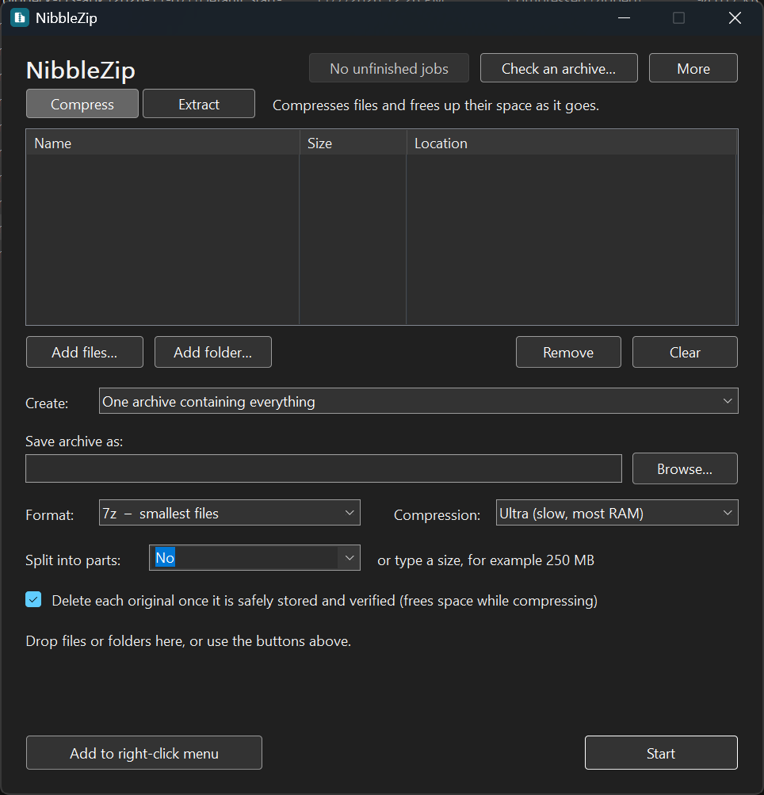
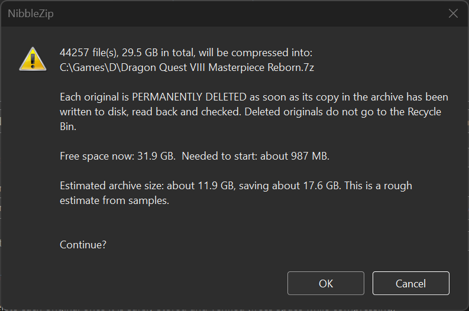
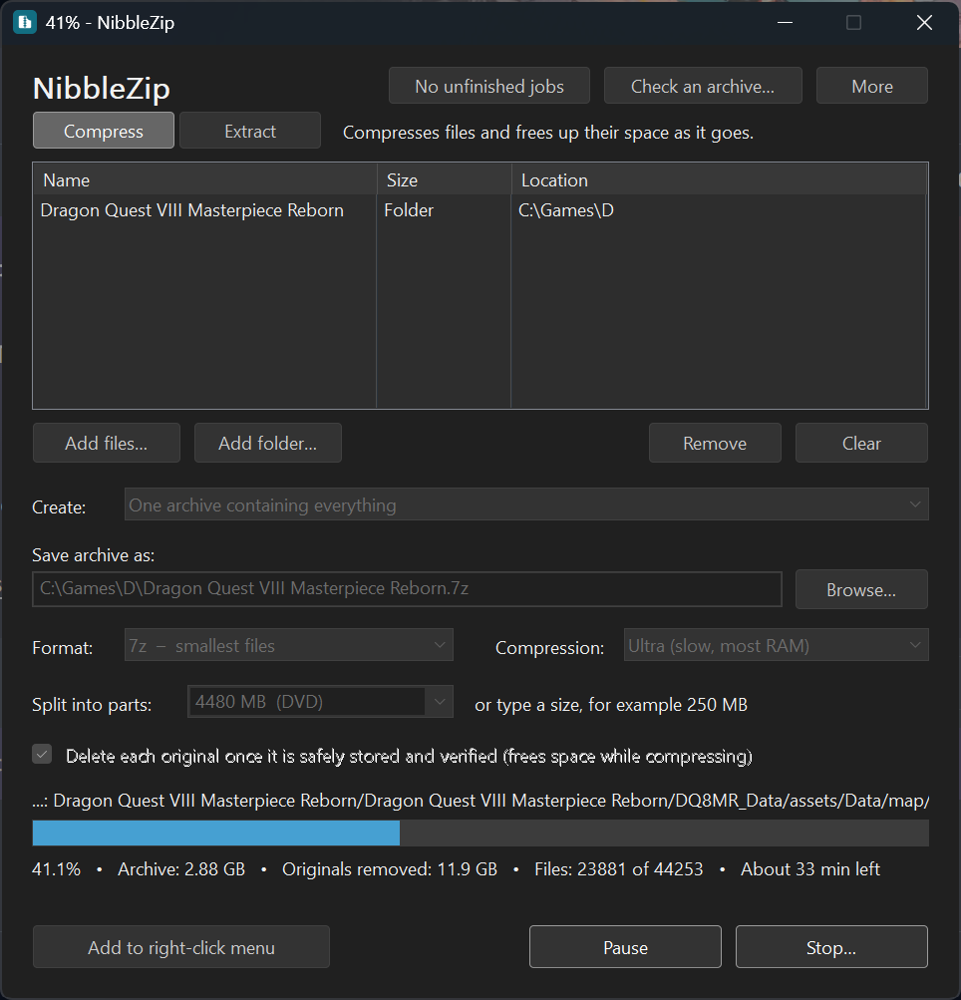
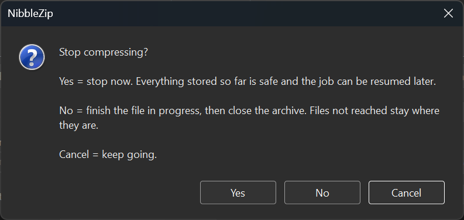
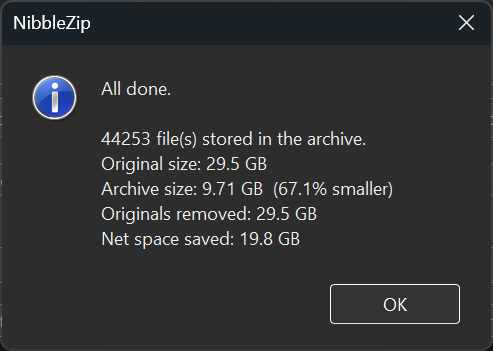
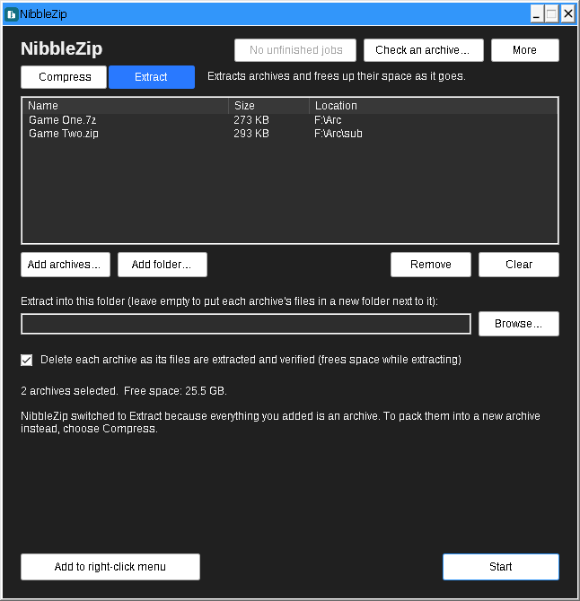
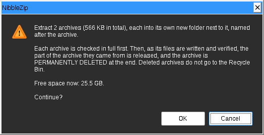
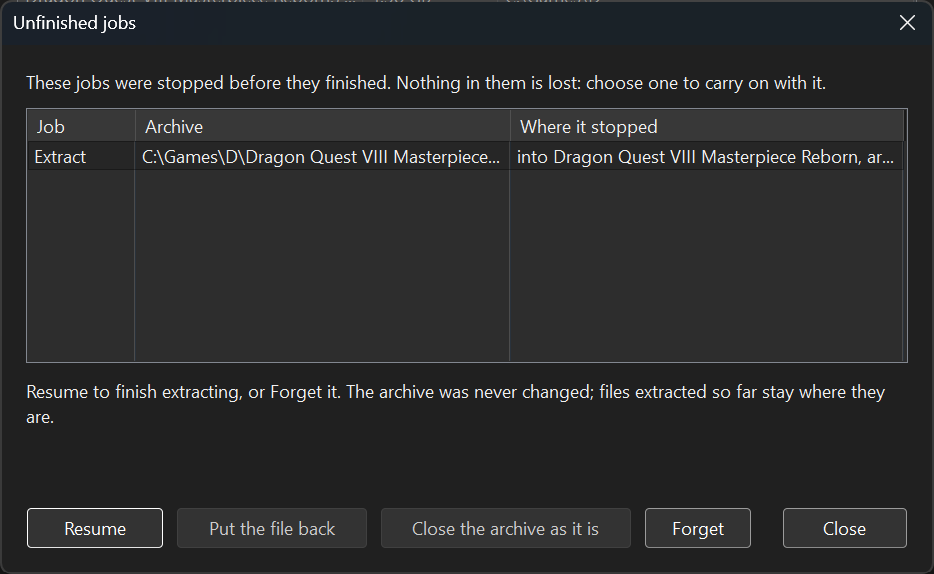
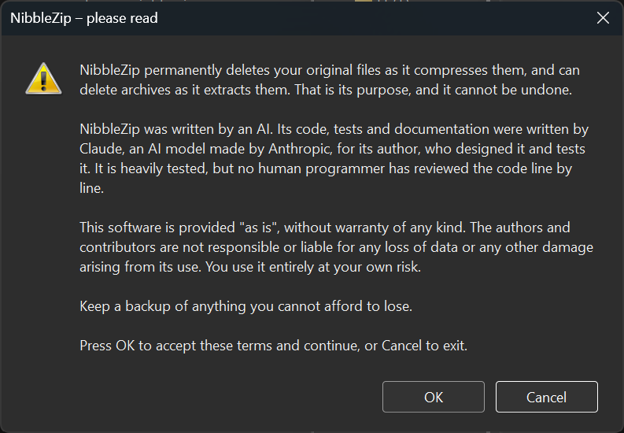

# NibbleZip

**Compress in place. Verify, then delete.**

NibbleZip compresses files into a 7z or ZIP archive and frees up the originals' disk space
*as it goes*, so you never need room for both the files and the archive at once. It also
works the other way: it extracts an archive while the archive gives its space back. It is
for the moment when a drive is too full to compress, or unpack, the things that are filling it.

> **Beta.** NibbleZip permanently deletes your original files as it compresses them. That
> is its purpose and it cannot be undone. Try it on copies first, and keep a backup of
> anything you cannot afford to lose. See "No warranty" below.

## Made with AI

This should be clear up front: **all of NibbleZip's code was written by an AI**, Claude
(made by Anthropic). So were the tests, the build scripts and this documentation.

The project's author, cloudhaacker, had the idea (a tool that does what HatchZip does, in
reverse), decided what it should do and how it should behave, and tests every version by
hand on real Windows. He is not a programmer and did not write or review the code line by
line.

What that means for you:

- Treat it as you would any new, unaudited tool that deletes files: try it on copies first.
- The safety of the design does not rest on trusting the code by eye. Every step is verified
  from disk before anything is deleted, and the test suite kills the program at every stage
  of every kind of job to prove it recovers. Those tests are in this repository and run
  automatically on every change.
- The source is all here. Reviews, bug reports and criticism are very welcome.

## Download

Get the latest `NibbleZip-x.y.zip` from the [Releases](../../releases) page, unzip it
anywhere and run `NibbleZip.exe`. There is nothing to install. It needs 64-bit Windows 10
or 11.

Windows may show a blue "Windows protected your PC" box because the program is not
code-signed: choose **More info > Run anyway**.

## Using it

1. Drag files or folders into the window, or use **Add files / Add folder**.
2. Pick 7z (smallest) or ZIP (opens everywhere) and a compression level.
3. Make sure **Compress** is selected at the top, press **Start** and read the confirmation. It tells you what will be deleted, how much
   free space is needed and roughly how big the archive will be.

While it runs you can pause, or stop and pick the job up again later.

Stopping asks whether to stop at once or finish the file in progress first. Either way,
everything already stored is safe.

Untick "Delete each original..." to use it as an ordinary archiver. That is the best way
to try it for the first time.

**Add to right-click menu** puts "Compress and reclaim space (NibbleZip)" on the right-click
menu of files and folders (under "Show more options" on Windows 11). Select as many items
as you like; they all arrive in one window.

## Extracting

The **Compress / Extract** switch at the top of the window chooses what Start does. The
window always opens in Compress. If you drop or pick only archives into an empty list, it
switches to Extract by itself and says so; choose Compress to pack them into a new archive
instead. In Extract mode, adding a folder adds every archive inside it. You can also
right-click archives in Explorer and choose "Extract and reclaim space (NibbleZip)", which
opens them in the window ready to extract. Any number of archives can be extracted in one go.

- **Delete each archive as its files are extracted** (ticked by default). The whole archive
  is decompressed and checked against its checksums first, and nothing is touched if that
  fails. Then its files are written out, and as each stretch of them is verified on disk,
  the part of the archive they came from is released. When everything is out and verified,
  what is left of the archive is removed.
- **Untick it** to extract only and leave the archive exactly as it was.

Each archive's files go into a new folder named after it, next to the archive or inside a
folder you pick. If one archive in a batch cannot be extracted (for example it is
password-protected), it is left untouched and the rest carry on. Stop, a crash or a power
cut can be resumed just like compression.

It reads 7z archives that use LZMA2, LZMA or no compression (including 7-Zip's filter for
programs), and ZIP archives that use Deflate or no compression. Anything else, such as
password-protected archives, is refused with a message before anything is changed, and RAR
is not supported.

## Features

- **Create** one archive containing everything, a separate archive for each item in the
  list, or a separate archive for each file (for example a ROM folder where every game
  becomes its own zip). Separate archives are named after their originals and go next to
  them, or into a folder you pick. Items whose archive already exists are left alone, so
  pressing Start again after a stop simply carries on.
- **Split into parts** writes the archive as `name.7z.001`, `name.7z.002` and so on, each
  of the size you choose (pick a preset or type one, such as `250 MB`). Open or check a
  split archive by choosing its `.001` part; all parts must be in the same folder. 7-Zip,
  WinRAR and PeaZip open these parts directly. Windows' built-in zip viewer does not.
- **Check an archive** re-reads a finished 7z or ZIP from disk, decompresses every file and
  compares it with its stored checksum.
- **Estimate.** Before a job starts, the confirmation shows a rough estimate of the archive
  size and the space you will save, worked out by compressing samples of your files.
- **Already-compressed data** (video, music, zips, most game archives) is detected by
  sampling and stored as it is instead of being recompressed, which is many times faster
  for almost no size difference.
- **Stop and resume.** After a stop, a crash or a power cut, nothing is lost. The
  **Unfinished jobs** button lists every compression and extraction that was stopped before
  it finished, and opens by itself when NibbleZip starts. From there you can resume a job,
  put a half-processed file back, close an archive as it is, or (for an "extract only" job)
  forget it. An unfinished job keeps a claim on everything it works on (its files and
  folders, its archive, and for an extraction the folder it is extracting into), and no new
  job may touch any of that until the job is finished.

  

- **Undo for a half-finished big file.** If a job was stopped part-way through a large
  file, you can instead put that file back exactly as it was and close the archive.
- **More** holds the **Deletion log** (a plain text list of every original NibbleZip has
  removed, with the date, size and the archive it went into), the **Theme** (follow Windows,
  light or dark) and **About**.

## How it stays safe

- **Check before starting.** It works out how much free space one step needs and refuses to
  start if that is not available.
- **Verify, then delete.** Each chunk is written to the archive, forced to disk, read back
  from disk, decompressed, and compared byte for byte with the source. Only then is the
  source released.
- **Journal.** Every committed step is recorded in a small `.nzj` file next to the archive,
  with a second copy under `%LOCALAPPDATA%\NibbleZip\journals`.
- **Always a valid archive between files.** The archive index is rewritten after every file
  or batch.
- Files that are in use, change while being read, or are links or junctions are skipped
  and left alone.

The full design, including why a crash at any point cannot lose data and how that is
tested, is in [docs/HOW-IT-WORKS.md](docs/HOW-IT-WORKS.md).

## How space is reclaimed

- Small files are compressed together in batches; the whole batch is deleted once verified.
- A file bigger than one step (64 MB to 1 GB depending on level and RAM) is compressed a
  step at a time, and the part already stored is released from inside the file (NTFS
  sparse "hole punching"). A half-processed big file is therefore only complete again once
  the job is resumed and finished, or undone.

## Limits

- Deleted originals do not go to the Recycle Bin.
- Releasing space inside a big file needs NTFS. On exFAT or FAT32 drives a big file is only
  freed when it is finished, so it needs room for its compressed copy.
- The archive must be on the same drive as the files for the space saving to matter.
- RAR archives cannot be created: the RAR compressor is proprietary to WinRAR.
- 7z archives are written in solid blocks of one step rather than one giant solid block.
- No password protection yet.
- When extracting, space is released at safe restart points inside the archive. A 7z made
  with multi-threaded LZMA2 (7-Zip's default, and what NibbleZip writes) has one every block,
  and a ZIP has them throughout. A 7z packed as one single-threaded solid block, or with the
  older LZMA method, has none, so its space comes back only when that block is finished.
- A partly extracted archive is no longer a complete archive. Finish the extraction; do not
  move or edit the archive or the journal in between.

## No warranty, use at your own risk

The software is provided "as is", without warranty of any kind. The authors and
contributors are **not responsible or liable for any loss of data** or any other damage
arising from its use. See [LICENSE.txt](LICENSE.txt) for the full terms. The app asks you
to accept this the first time it runs, and again whenever those terms change.

## Building

Every release on the Releases page is built by GitHub from this source by
[the workflow in this repository](.github/workflows/build.yml), which also runs the test
suite first.

To build it yourself you need Python with `pip install ziglang`, plus the 7-Zip sources
(only the public-domain `C/` folder is used) and zlib:

    mkdir deps
    git clone --depth 1 --branch 26.06 https://github.com/ip7z/7zip.git deps/7zip
    git clone --depth 1 --branch v1.4 https://github.com/madler/zlib.git deps/zlib

    ./build-windows.sh           # NibbleZip.exe and nibblezip-cli.exe (cross-compiled)
    ./build-linux.sh             # command-line build used by the tests
    python3 tests/run_tests.py   # round-trips against 7-Zip and unzip, a crash injected at every checkpoint
    python3 tests/batch_test.py  # separate-archive modes
    python3 tests/extract_test.py  # extraction, against archives made by 7-Zip and others
    python3 tests/big_test.py    # files over 4 GB, peak disk use

The tests need 7-Zip (`7zz` or `7z`) and `unzip` on the PATH.

## Credits

Idea, direction and testing on real Windows: cloudhaacker. Code, tests and documentation:
Claude, an AI model made by Anthropic, working from his requests. Commits carry a
`Co-Authored-By: Claude` line for that reason.

Inspired by [HatchZip](https://hatchzip.dev), which extracts archives while shrinking them.
NibbleZip started as the reverse of that idea. Its own extraction works differently (front
to back, releasing space inside the file) and it shares no code with HatchZip.

Compression code: LZMA SDK by Igor Pavlov (public domain) and zlib by Jean-loup Gailly and
Mark Adler (zlib licence).
